///*

 #photogalleryclick .photoclickgallery
    {
        position:absolute;
        top: 280px;
        margin-left: -57%;
        width: 860px;
        z-index: 1;}

{
        splay: none;
        text-align: center;
        width: 100%;
}

############################# REDOING
>>>>>>>>>>> CSS
.photoclickgallery
    {
        position:absolute;
        top: 280px;
        margin-left: -57%;
        width: 860px;
    }

    #photodecoration
    #photodecoration.photoclickgallery
    {
    
        position:absolute;
        top: 280px;
        margin-left: -57%;
        width: 860px;
    
    }

    #photodecoration .photoclickgallery
    {
        transition: all 0.3s ease;
        cursor: pointer;
    }

    #photodecoration .photodecoration:hover {
        transform: scale(1.1);
        filter: brightness(0px 0px 15px rgba (161, 98, 16, 0.5));
    }
    
#photogalleryclicked

#photogalleryclicked {
        splay: none;
        text-align: center;
        width: 100%;
}

 
    
    .photogallerytitle
    { 
        font-family: Georgia, monospace; 
        font-size: 170px;
        margin: 0;
        position:relative;
        top: 20px;
        text-align: center;
        background: linear-graent(to bottom, #772A00 20%, #a16210 80%) !important;
        -webkit-background-clip: text !important;
        background-clip: text !important;
        -webkit-text-fill-color: transparent !important;

    }

>>>>>>>>>>>> HTML
 HOME<<<<< <v><v id="photogalleryclick" class="photogallery"></v>
         

    <v id="photogalleryclicked"></v> 
    <v id="gallerytitle" class="photogallerytitle">  
        <h2>Welcome to my cat gallery</h2>
    </v>

  

>>>>>>>>>>>>>> JS

const gallerybutton = document.getElementById('photodecoration');
        const home = document.getElementById('home1');
        const gallerytitle = document.getElementById('gallerytitle');

        gallerybutton.addEventListener('click', () => {
            home.style.splay = 'none'
            gallerytitle.style.splay = 'flex'
        });

############################################################

<v id="home">
    <v class="title-box">
   <v class="title">
    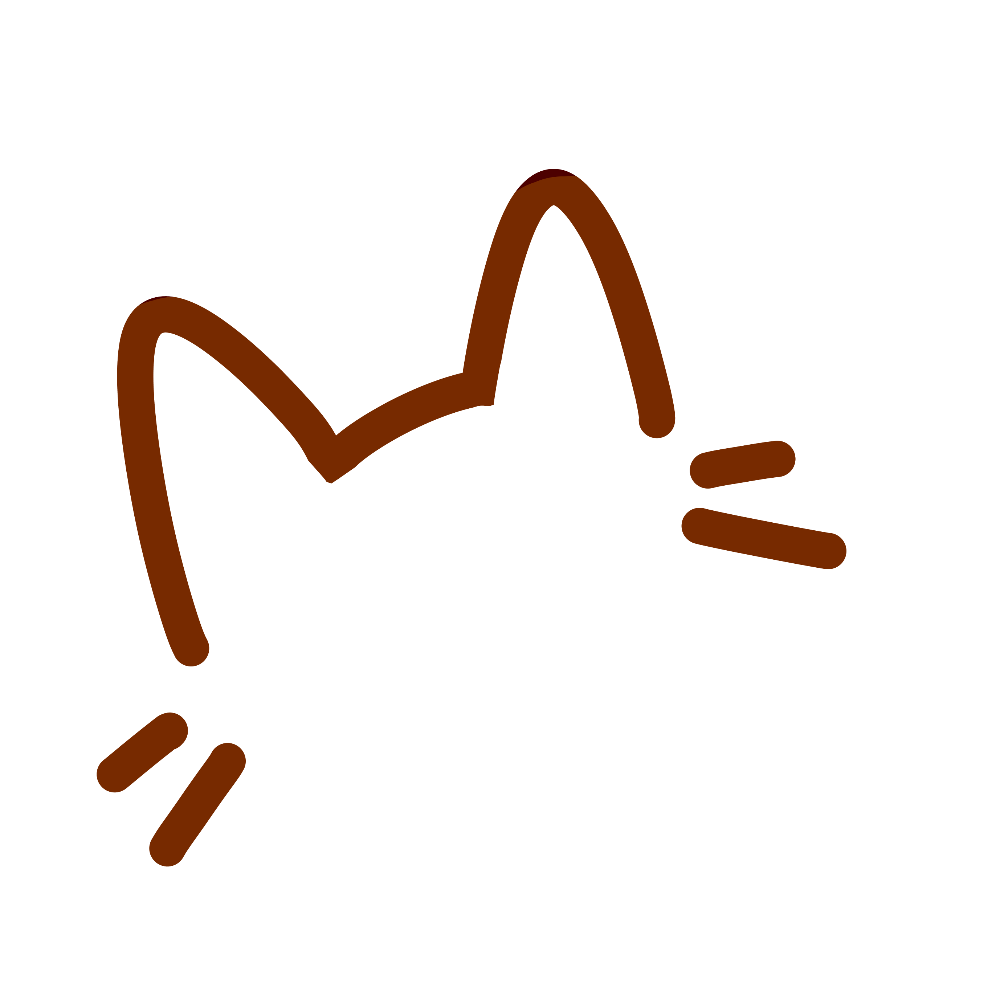
    <v class="title">
        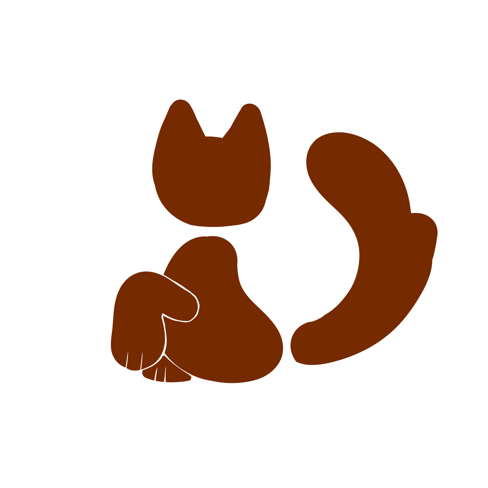
     <h1 class="graenttitletext"> Catnip </h1>
     </v> 
   </v>
   <v id="playaction" class="play">
    
    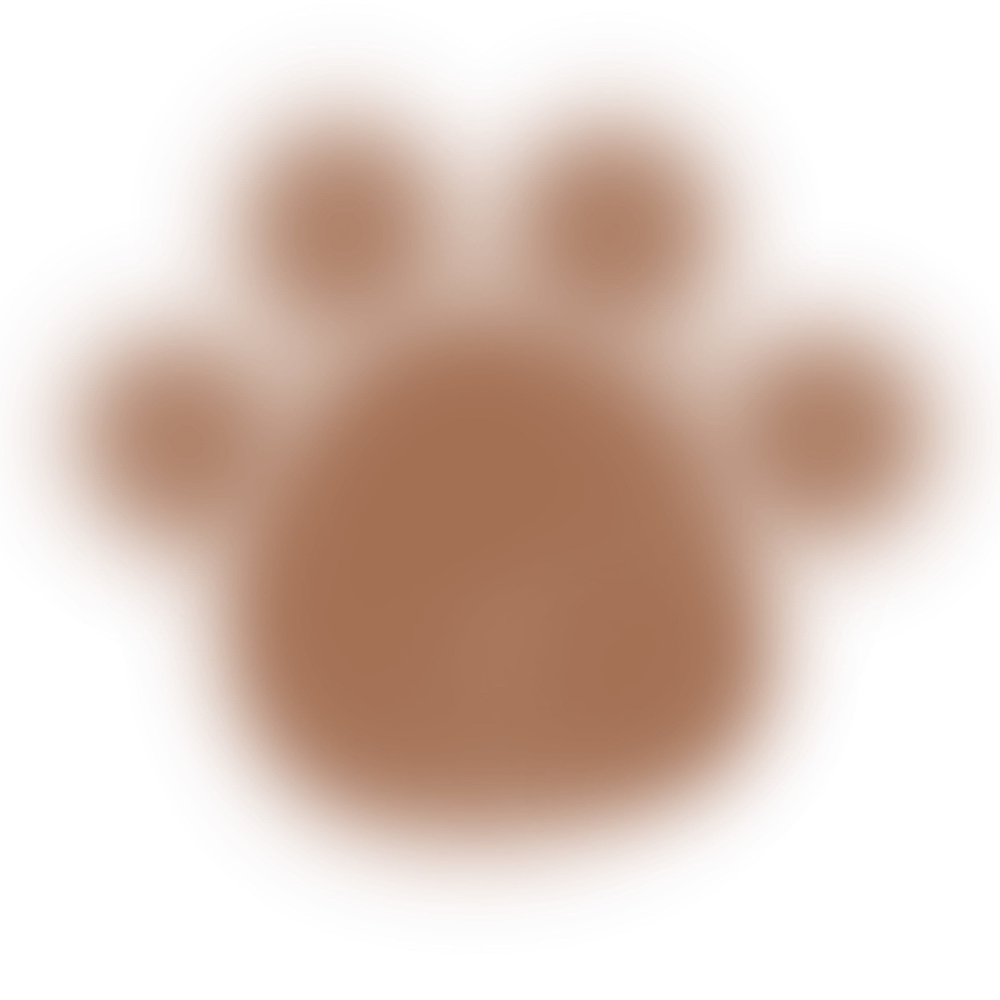 
    </v>
    </v>
    
  

<v id="game1">
    <v id = "game1title" class="title1">
   <h1> PUSSLE </h1>
    </v> </v>

###########################################################
 <v id="buttonchangepage1"><button onclick="changepage">go to page 2</button>
    <button onclick="alternaction()">
        <h1> button</h1>
    </button> </v>

###########################################################
function back() {

    document.getElementById('game1').style.splay = 'none'
    document.getElementById('homepage').style.splay = 'block'

     game1button.addEventListener('click', () => {
            game1.style.splay = 'none';
            homepage.style.splay = 'flex'
        });
}       

###########################################################

 id="galleryaction"  class="galleryphoto"

<v class="photog">
    
        </v>

############################################################

 #game1 h1 {
        font-family: Georgia, monospace; 
        font-size: 250px;
        margin: auto;

#############################################################
<v class="buttononclickback"> </v>

##############################################################
 margin-top: 6%;
        margin-left: 20%;
############################ 
s#puzzle-board {
                border: 2px solid #b66904; 
                background-color: #5a3210; 
                padng: 0%;
                width: 600px;
                height: 600px;
                splay: grid;
                margin-left: 33%;
                position: absolute;
                top: 600px;
               
             }
##################################

 #game1 .welcometext {
        position: relative;
        font-family: cursive; 
        font-size: 50px;
        
        
        margin-left: 40% auto;
        margin-right: 28% auto;

        margin: auto;
        margin-top: 500px;
        
        align-items: center;
        text-align: center;
        color: #772A00;
    }

######################################
margin-left: auto;
        margin-right: auto;
#####################################
padng-inline: 50%;
margin-inline: 50%;

left: 25%;
        right: 25%;
        margin-right: 25%;
        margin-left: 25%;
#######################################
 <v class="welcometext"><h3> welcome to my cars game:3</h3></v>

#######################################

var rows = 3;
var columns 3;

var currTile;
var otherTile;

##########################################

botón de regreso en la pagina de pussle

<button onclick="back()" class="buttononclickback">back</button>

##########################################

h3 {
        position: absolute;

        left: 50%;
        transform: translateX(-50%);

        width: 404px;
        margin-top: 500px;
        
        
        font-family: cursive; 
        font-size: 30px;
        color: #772A00;
        text-align: center;

    }

################################################

    .play {
        position: relative;
        height: 50%;
        margin-top: 180px;
        margin-left: 15%;
        width: 300px;

################################################

    .photog {
        position: absolute;
        top: -160px;
        left: -5%;
        height: 20p0x;

    }
    .photog {
        transition: all 0.3s ease;
        cursor: pointer;
    }
    .photog :hover {
       transform: scale(1.1);
       filter: brightness(0px 0px 15px rgba (161, 98, 16, 0.5));
    }

<<<<<<<<<<<<<<<<<<<<<<<<<<<<< SOLVE
H1 CSS RELATED TO ALL H1
PUSSLE & GALLERY CURSOR FOLLOWER
MAKE AN EFFECT FOR ALL IMAGES IN GALLERY, ADD MORE IMAGES
SOLVE THE HOMEPAGE CSS

###############################################

left: 50%;
       transform: translateX(-50%);
    /*HOME PAGE BODY*/

.title-box
    {
       position: relative;
       width: 200px;
       max-width: 1200px;
       
       height: 200px;

##################################################

=> {

      }
      {
        cursor.style.left = `$ 
        {e.clientX}px`;
              cursor.style.top = `$ 
              {e.clientY}px`;});

#######

transition: all 0.3s ease;
        cursor: pointer;

########

<h3>Goku</h3>

h1:hover{
        transform: scale(1.1,1.1);
        
    }
############################## js
const button = document.querySelectorAll('button');

   button.forEach(button => {
    button.addEventListener('mouseenter', () =>
    {
      cursor.classList.add('active');
    });
    button.addEventListener('mouseleave', () =>
    {
      cursor.classList.remove('active');
    });
    
  });

##############################################
function back() {

       document.getElementById('game1').style.splay = 'none'
       document.getElementById('homepage').style.splay = 'block'

       game1button.addEventListener('click', () => {
              game1.style.splay = 'none';
              homepage.style.splay = 'block'
        });

        const game1button = document.getElementById ('buttonchangepage1');
        const homepage = document.getElementById('homepage')
        const game1 = document.getElementById('game1')
            const rows = 3;
            const columns = 3;
            const board = document.getElementById('puzzle-board');

        game1button.addEventListener('click', () => {
            homepage.style.splay = 'none'
            game1.style.splay = 'flex';

            if (board) {
            board.style.gridTemplateColumns = `repeat(${columns}, 1fr)`;
            board.style.gridTemplateRows = `repeat(${rows}, 1fr)`;
    }s
        });
}    
#######################
            const rows = 3;
            const columns = 3;
            const board = document.getElementById('puzzle-board');
            if (board) {
            board.style.gridTemplateColumns = `repeat(${columns}, 1fr)`;
            board.style.gridTemplateRows = `repeat(${rows}, 1fr)`;
###########################
.backbuttonimg {
        cursor:url('pointer2.png') 4 4, pointer;
        }
        ########################

        .B-B-2:hover {
    transform: scale(1.1);
    transition: 0;
    filter: brightness(135%);
    transition: 0.2s;

     cursor:url('pointer2.png') 4 4, default;}

     ######################
  let draggedPiece = null;

pieces.forEach(piece => {

  piece.draggable = true;

  piece.addEventListener("dragstart", () => {
    draggedPiece = piece;
  });

  piece.addEventListener("dragover", (e) => {
    e.preventDefault();
  });

  piece.addEventListener("drop", () => {

    if (draggedPiece === piece) return;

    const tempBg = piece.style.backgroundPosition;
    piece.style.backgroundPosition =
      draggedPiece.style.backgroundPosition;

    draggedPiece.style.backgroundPosition = tempBg;
  });

});
########################   

id= "out-container-byID"

#############################################

THIS IS AN AI GENERATED CODE, I'M NOT USING AI IN MY CODE, BUT JS IS VERY HARD TO UNDERSTAND AND I'M ASKING AI TUTORIALS

  for (let y = 0; y < size; y++) {
  for (let x = 0; x < size; x++) {

    const piece = document.createElement("v");

    piece.classList.add("piece");

    piece.dataset.correctX = x;
    piece.dataset.correctY = y;

     piece.style.backgroundPosition =
      `-${x * 200}px -${y * 200}px`;

    pieces.push(piece);
  }
}
pieces.sort(() => Math.random() - 0.5);

// Agregar al tablero
pieces.forEach(piece => {
  board.appendChild(piece);
});

// Drag & Drop
let draggedPiece = null;

pieces.forEach(piece => {

  piece.draggable = true;

  piece.addEventListener("dragstart", () => {
    draggedPiece = piece;
  });

  piece.addEventListener("dragover", (e) => {
    e.preventDefault();
  });

  piece.addEventListener("drop", () => {

    if (draggedPiece === piece) return;

    const tempBg = piece.style.backgroundPosition;
    piece.style.backgroundPosition =
      draggedPiece.style.backgroundPosition;

    draggedPiece.style.backgroundPosition = tempBg;
  });

});

#############################
               #piece1 {
                
                 
                 splay: flex;
                 width: 300px;
                 height: 300px;
                 box-sizing: border-box;
                 border: 1px solid #a16210;
                 splay: block;
                 

             }
             #piece2 {
                
                 
                 splay: flex;
                 width: 300px;
                 height: 300px;
                 box-sizing: border-box;
                 border: 1px solid #a16210;
                 splay: block;
                 

             }
             #piece3 {
                
                 
                 splay: flex;
                 width: 300px;
                 height: 300px;
                 box-sizing: border-box;
                 border: 1px solid #a16210;
                 splay: block;
                

             }
             #piece4 {
                
                 
                 splay: flex;
                 width: 300px;
                 height: 300px;
                 box-sizing: border-box;
                 border: 1px solid #a16210;
                 splay: block;
                

             }
             #piece5 {
                
                 
                 splay: flex;
                 width: 300px;
                 height: 300px;
                 box-sizing: border-box;
                 border: 1px solid #a16210;
                 splay: block;
                

             }
             #piece6 {
                
                 
                 splay: flex;
                 width: 300px;
                 height: 300px;
                 box-sizing: border-box;
                 border: 1px solid #a16210;
                 splay: block;
                

             }
             #piece7 {
                
                 
                 splay: flex;
                 width: 300px;
                 height: 300px;
                 box-sizing: border-box;
                 border: 1px solid #a16210;
                 splay: block;
                

             }
             #piece8 {
                
                 
                 splay: flex;
                 width: 300px;
                 height: 300px;
                 box-sizing: border-box;
                 border: 1px solid #a16210;
                 splay: block;
                

             }
             #piece9 {
                
                 
                 splay: flex;
                 width: 300px;
                 height: 300px;
                 box-sizing: border-box;
                 border: 1px solid #a16210;
                 splay: block;
                

             }
            ################################
               <v id="piece1" draggable="true">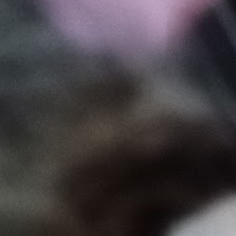</v>
            <v id="piece2" draggable="true">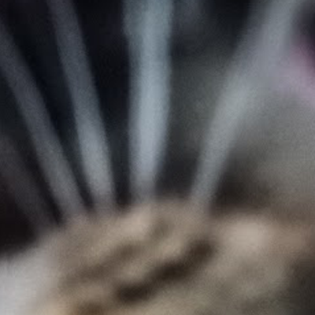</v> 
            <v id="piece3" draggable="true">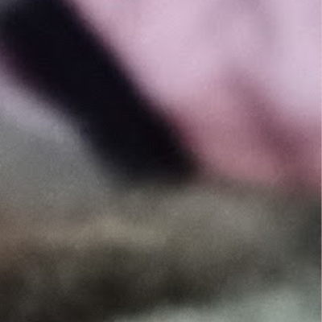</v>
            <v id="piece4" draggable="true">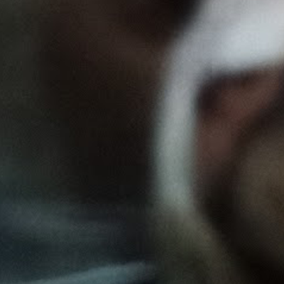</v>
            <v id="piece5" draggable="true"></v>
            <v id="piece6" draggable="true">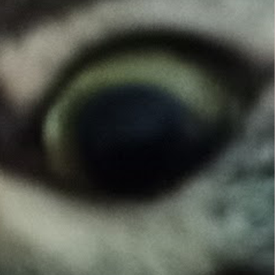</v>
            <v id="piece7" draggable="true">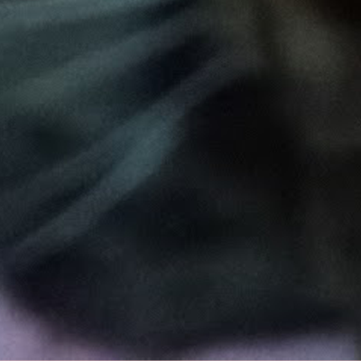</v>
            <v id="piece8" draggable="true">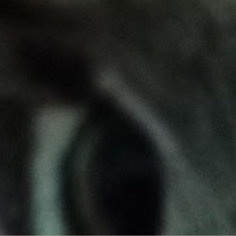</v>
            <v id="piece9" draggable="true">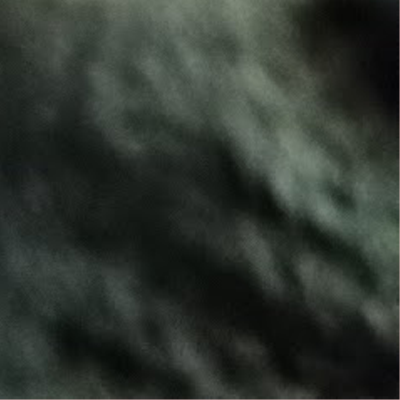</v>   

###################################
< v id="pieces-container"></v> 
##################

            
            
            
            
            
            
            
            

############################
 #puzzle-board 
    
               .board-pieces {
                
                position: absolute;
                border: 12px solid #b66904; 
                background-color: #c2a58d; 
                padng: 0%;
                width: 900px;
                height: 900px;
                splay: grid;
                left: 50%;
                transform: translateX(-50%);
                splay: flex;
                margin-top: 30%;
                
                flex-wrap: wrap;
               
             }
               img {
                
                 
                 splay: flex;
                 width: 300px;
                 height: 300px;
                 box-sizing: border-box;
                 border: 1px solid #a16210;
                 splay: block;
                

             }

###################################
align-items:center;
                left: 10%;
                transform: translateX(-50%);
                
                position: absolute;
                border: 4px solid #b66904; 
                background-color: #c2a58d; 

                height: 800px;
                width: 330px;
                splay: grid;
                
                splay: flex;
                padng: 10px;
                
                top: 58%;
                
                flex-wrap: wrap;

  #########################################
  class="draggable-piece"
  ####################################
  const cursor = document.querySelector('.custom-cursor');
      document.addEventListener('mousemove', (e) =>
      {
        cursor.style.left = e.clientX + 'px';
        cursor.style.top = e.clientY + 'px';

      });

const button = document.querySelectorAll('button');

   button.forEach(button => {
    button.addEventListener('mouseenter', () =>
    {
      cursor.classList.add('active');
    });
    button.addEventListener('mouseleave', () =>
    {
      cursor.classList.remove('active');
    });
    
  });

####################################################
splay: block;
 
                position: absolute;
                border: 12px solid #b66904; 
                background-color: #c2a58d; 
                padng: 0%;
                width: 900px;
                height: 900px;
                splay: grid;
                left: 50%;
                transform: translateX(-50%);
                splay: flex;
                margin-top: 30%;
                
                flex-wrap: wrap;
##############################################

#WELCOME WINDOW DO LATER*********

<v id="welcome-modal" >
    <v class="modal-background"></v>

<v id="welcome-text">
 welcome to my cars game:3
</v>

<v id="close-button"></v>
</v>

#welcome-modal {
        display: flex;

}

     .modal-text {
        position: absolute;
        left: 50%;
        transform: translateX(-50%);
        
        

        width: 56%;
        
        font-family: sans-serif; 
        font-size: 200px;
        color: #772A00;

        
    }

     .closebutton {
        position: absolute;
        left: 50%;
        transform: translateX(-50%);
        height: 330px;
        
        
        width: 330px;
        top: 90%;
        font-family: sans-serif; 
        font-size: 200px;
        color: #772A00;
}
   
    .modal-background {
        
        position: absolute;
        
        filter: blur(80%);
        
        width: 100%;
        height: 100%;
        width: 100%;
        
        z-index: 1;
        color: #0b0501;
    }

const welcometext = document.querySelector('h3')
function 

###########################################

slots.classList.add('slots'));

      board.appendChild(slot);
  }

const pieces = document.querySelectorAll('.draggable-piece')
  pieces.forEach((piece, index) => {
    if(!piece.id) {
pieces.addEventListener('dragstart', (e) =>
   {
    e.dataTransfer.setdata('text/plain', e.target.id);
   });
  }});

    for (let i = 0;  i < size * size; i++) 

      pieces.forEach((piece) => {  
pieces.addEventListener('dragstart', (e) =>
   {
    e.dataTransfer.setData('text/plain', e.target.id);
   });
  });

  #####################
   filter: opacity(50%);
 filter: opacity(50%);
 filter: opacity(50%);
 filter: opacity(50%);
 filter: opacity(50%);
 filter: opacity(50%);
 filter: opacity(50%);
 filter: opacity(50%);
 filter: opacity(50%);

 ###################################################
 > {
    button.addEventListener('mouseenter', () =>
    {
      cursor.classList.add('active');
    });
    button.addEventListener('mouseleave', () =>
    {
      cursor.classList.remove('active');
    });
    
  });

  if (draggedPiece) {
          piecescontainer.appendChild(draggedPiece);
        }

################################
const piecescontainer = querySelector('.out.container')

        if (o.children.length === 0 && draggedPiece) {
          slot.appendChild(draggedPiece);
        }
      }))

            piecescontainer((container) => {

       container.addEventListener('dragover', (e) => {
            e.preventDefault();
          });
      
        container.addEventListener('drop', (e) => {
            e.preventDefault();
        
         if (piecescontainer){
             container.appendChild(draggedPiece);
         }
        
        })
###########################################

    *///